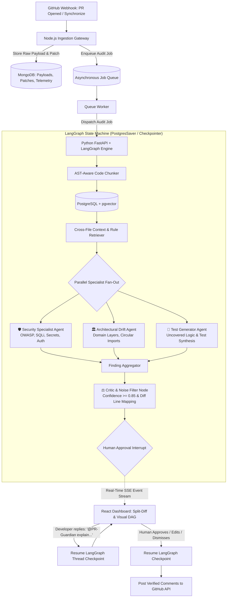

# 🛡️ PR-Guardian v2: Autonomous Codebase & Pull Request Reviewer

[](https://github.com/langchain-ai/langgraph)
[](https://github.com/pgvector/pgvector)
[](https://www.mongodb.com/)
[](https://react.dev/)
[](https://nodejs.org/)
[](https://www.python.org/)
[](LICENSE)

> **PR-Guardian v2** is an enterprise-grade autonomous pull request reviewer and interactive code review partner. It indexes entire codebases using **AST-aware semantic chunking**, queries a **PostgreSQL (pgvector)** code graph, dispatches **parallel specialist agents** (Security, Architecture, Test Generator), eliminates false positives via a **Critic Filter Node**, and features **Two-Way Conversational Thread Resumption** (developers can reply `@PR-Guardian explain why this is risky` directly on inline comments) alongside a **Live Visual Agent Execution DAG Graph**.

---

## ⚡ What's New in v2

* **💬 Two-Way Conversational Thread Resumption:** Developers can converse directly with PR-Guardian on any finding. LangGraph reloads the exact `thread_id` from the `PostgresSaver` checkpoint, answering follow-up questions in real time with full code context.
* **📊 Visual Agent Execution DAG Graph:** A sleek, interactive DAG diagram on the React dashboard rendering active nodes, execution times, token counts, and state transitions.
* **🚦 Asynchronous Job Queue Worker:** Decouples GitHub Webhook reception (`202 Accepted` in < 100ms) from long-running multi-agent LLM analysis, preventing webhook timeouts.
* **📈 Granular LLM Token & Latency Telemetry:** Tracks prompt tokens, completion tokens, latency (ms), and cost attribution stored in MongoDB.

---

## 🏗️ System Architecture



---

## 🧩 Tech Stack Breakdown

| Layer | Technology | Role |
| :--- | :--- | :--- |
| **Relational & Vector Store** | **PostgreSQL + `pgvector`** | Function embeddings, symbol signatures, team architectural rules, and LangGraph `PostgresSaver` checkpoints. |
| **Document & Trace Store** | **MongoDB** | Raw webhook JSON payloads, full unified git diff patches, and granular step-by-step LLM token/latency telemetry. |
| **Multi-Agent Orchestrator** | **LangGraph** (Python 3.13) | Stateful parallel agent fan-out, Critic node, Human-in-the-Loop interrupt, and multi-turn conversational thread resumption (`@PR-Guardian`). |
| **Code Intelligence** | **Tree-sitter / AST Chunker** | Deconstructs files along semantic syntactic boundaries (functions, classes, interfaces) preserving complete scope. |
| **Gateway & Job Queue** | **Node.js (Express) + Job Queue** | Immediate 202 webhook acknowledgment (< 100ms), concurrency control, and Server-Sent Events (SSE) broadcasting. |
| **Reviewer Dashboard** | **React 18 + Tailwind CSS** | Split-diff viewer with inline AI comments, conversational thread chat, and live visual Agent Execution DAG Graph. |

---

## 📂 Project Structure

```
pr-guardian/
├── docker-compose.yml             # Postgres (pgvector) + MongoDB + App services
├── init-postgres.sql              # Schema for pgvector embeddings & repo rules
├── .env.example                   # Environment configuration template
├── package.json                   # Root workspace scripts
├── TODO.md                        # Implementation progress tracker (All 7 Phases Complete)
│
├── ai-engine/                     # Python 3.13 + LangGraph Service (Port 8000)
│   ├── app/
│   │   ├── config.py              # Configuration & Critic thresholds
│   │   ├── db/
│   │   │   ├── postgres.py        # pgvector pool & in-memory fallback
│   │   │   └── mongo.py           # MongoDB trace logger & fallback
│   │   ├── parser/
│   │   │   └── ast_chunker.py     # AST function, class, and scope extractor
│   │   ├── vector/
│   │   │   ├── embeddings.py      # Dense vectorizer + embedding pipelines
│   │   │   └── retriever.py       # Global context & rule retriever
│   │   ├── agents/
│   │   │   ├── state.py           # LangGraph PRReviewState with thread replies & telemetry
│   │   │   ├── security.py        # OWASP, SQLi, secret detection agent
│   │   │   ├── architecture.py    # Domain layering & drift auditor
│   │   │   ├── test_generator.py  # Test gap detection & test synthesizer
│   │   │   └── critic.py          # Critic filter node (score >= 0.85)
│   │   ├── graph/
│   │   │   └── workflow.py        # LangGraph StateGraph & thread reply handler
│   │   └── main.py                # FastAPI routes, SSE streaming, and /audit/reply
│   ├── test_ai_engine.py          # Standalone verification test
│   ├── requirements.txt
│   └── Dockerfile
│
├── backend/                       # Node.js Ingestion Gateway (Port 5001)
│   ├── src/
│   │   ├── db/mongo.js            # MongoDB document client & fallback
│   │   ├── services/
│   │   │   ├── queue.js           # Asynchronous Ingestion Job Queue Worker
│   │   │   ├── diffParser.js      # Unified diff hunk line-number parser
│   │   │   └── github.js          # Webhook HMAC verifier & GitHub API poster
│   │   └── server.js              # Express REST, Webhook, and SSE hub
│   ├── package.json
│   └── Dockerfile
│
└── frontend/                      # React + Vite + Tailwind CSS (Port 3000)
    ├── src/
    │   ├── components/
    │   │   ├── Header.jsx         # Status badge & human approval controls
    │   │   ├── AgentExecutionDAG.jsx # Interactive Visual DAG Graph with live telemetry
    │   │   ├── SplitDiffViewer.jsx# Side-by-side diff with Two-Way Thread Conversation
    │   │   └── SynthesizedTestsModal.jsx # Auto-generated unit test viewer
    │   ├── App.jsx                # Main review studio page
    │   ├── main.jsx
    │   └── index.css
    ├── package.json
    └── vite.config.js
```

---

## 🚀 Quickstart Guide

### Option 1: Docker Compose (All Services)
```bash
cd "pr_gardian"
cp .env.example .env
docker compose up --build
```

### Option 2: Local Development (With Built-in Fallbacks)

1. **Start the Python AI Engine:**
   ```bash
   cd "ai-engine"
   source .venv/bin/activate
   uvicorn app.main:app --port 8000 --reload
   ```

2. **Start the Node.js Gateway:**
   ```bash
   cd "backend"
   npm run dev
   ```

3. **Start the React Frontend:**
   ```bash
   cd "frontend"
   npm run dev
   ```

Visit [http://localhost:3000](http://localhost:3000) in your browser!

---

## 🧪 Interactive Live Demo

1. Open [http://localhost:3000](http://localhost:3000).
2. Click **"Seed Demo PR"** in the top header.
3. Observe the **Visual Agent Execution DAG Graph** light up as each stage completes with real-time latency and token metrics.
4. On any inline review comment, type in the thread box:
   * `@PR-Guardian explain why this is risky`
   * Or click the quick chip **"🛠️ How to fix"**
5. Watch PR-Guardian rehydrate the LangGraph thread state and formulate an intelligent response right inside the review card!
6. Click **"Approve & Post to GitHub"** to simulate full dispatch.

---

## 🤖 GitHub Actions Integration

PR-Guardian includes a complete suite of GitHub Actions workflows in `.github/workflows/` and an official composite action in `action.yml`:

1. **`ci.yml`**: Continuous Integration testing Python 3.13 AI Engine, Node.js backend syntax, and React Vite build.
2. **`pr-guardian-review.yml`**: Autonomous review workflow triggered on `pull_request: [opened, synchronize]`, extracting the PR diff, running multi-agent analysis, and posting verified review comments directly to the PR.
3. **`docker.yml`**: Validates `docker-compose.yml` and builds all container images.
4. **`action.yml` (Plug-and-Play Reusable Action)**: Any repository can use PR-Guardian directly in their workflow:

```yaml
name: PR Code Review
on: [pull_request]

jobs:
  review:
    runs-on: ubuntu-latest
    steps:
      - uses: actions/checkout@v4
        with:
          fetch-depth: 0
      - name: Run PR-Guardian Review
        uses: priyanshunayak/pr-guardian@v2
        with:
          github-token: ${{ secrets.GITHUB_TOKEN }}
          min-confidence: "0.85"
```

---

## 📄 License

MIT License. Designed and built for Software Engineering, DevTools, and AI Engineering architectures.
